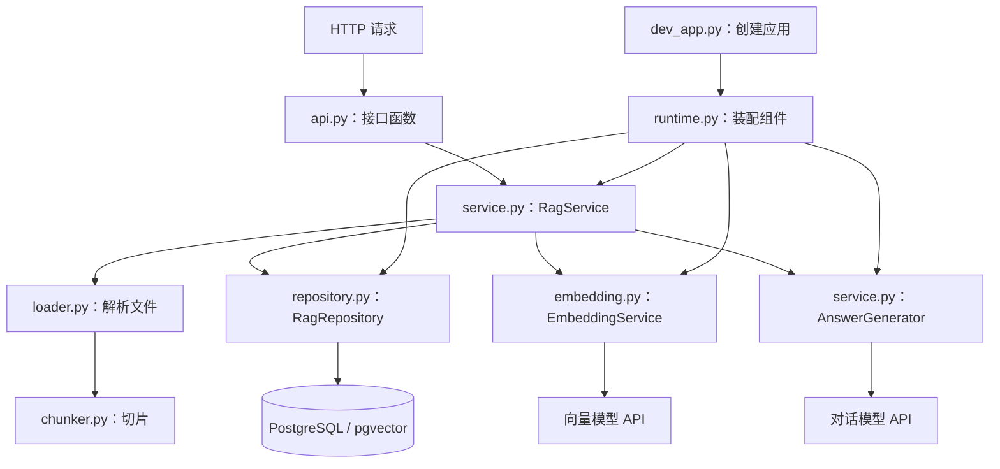
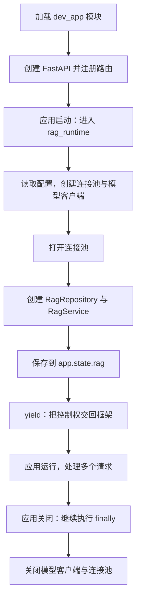
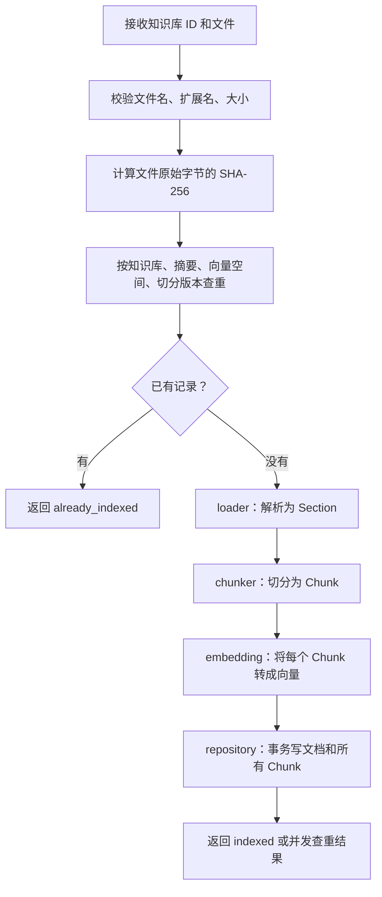
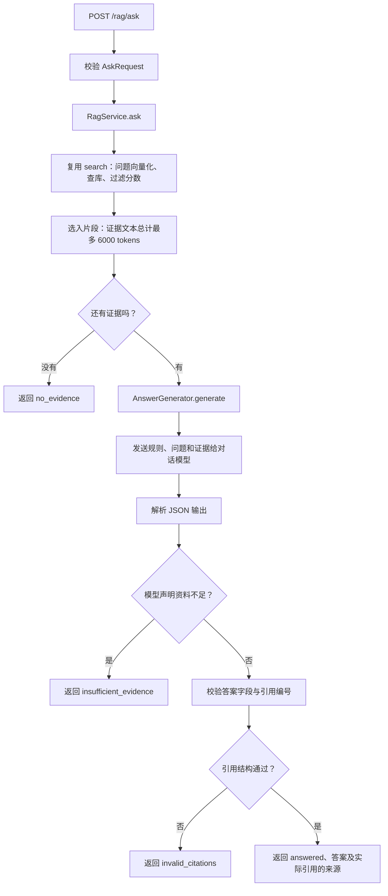

# 从 Java 到 Python：读懂 rag3

这份指南对应 `apps/python-agent/app/rag3` 的当前源码，面向有 Java 基础、刚接触 Python 的开发者。

先记住主线：**上传文档时建立可检索的资料库；提问时检索资料，再把问题和资料交给模型。**

当前源码有几处命名、缩进和配置不一致，见文末。下面的业务流程表示设计意图，不能据此认为当前版本已经可以直接启动。本文只增加说明，不修改业务代码。

## 1. 先用 Java 的分层理解整个目录

| Python 文件 | 类比 Java / Spring | 在这里做什么 |
| --- | --- | --- |
| `dev_app.py` | 应用启动配置 | 创建 FastAPI 应用、安装路由和校验异常处理 |
| `runtime.py` | 手写 Bean 装配、启动/销毁回调 | 创建连接池、Repository、两个模型客户端和 Service |
| `api.py` | Controller + 部分异常处理器 | 接收上传、检索和问答请求，调用 Service |
| `schemas.py` | DTO + Bean Validation | 定义请求、响应以及字段约束 |
| `service.py` | Service | 串联入库、检索、问答；其中还有生成答案的客户端封装 |
| `loader.py` | 文件解析工具 | 从 PDF、Markdown、TXT 提取带位置信息的文本段 |
| `chunker.py` | 文本切分工具 | 把文本段进一步切成适合检索的小片段 |
| `embedding.py` | 外部服务 Client | 把文本转换为数值向量 |
| `repository.py` | DAO / Repository | 直接执行 SQL，保存文档、保存片段、相似度检索 |
| `settings.py` | `@ConfigurationProperties` 的近似角色 | 定义配置项、读取配置、缓存配置对象 |
| `errors.py` | 自定义业务异常 | 携带业务错误码、消息和 HTTP 状态码 |

这些是职责类比，不代表这里使用了 Spring 的自动注入、代理事务或 ORM。这里的对象基本由 `runtime.py` 显式创建、传递。



**箭头表示创建或调用关系，不表示这些文件按从上到下的顺序各执行一次。**

## 2. Python 文件到底怎么执行？

Java 中你通常先找 `main()`。这里应先找 ASGI 应用对象 `app`。

独立 RAG 入口是 `dev_app.py` 中的：

```python
app = FastAPI(title="Enterprise Data Copilot - Week 3", lifespan=rag_runtime)
install_rag_routes(app)
```

用类似下面的命令，可以指定要加载哪个模块中的哪个对象：

```bash
# 在 apps/python-agent 目录中，通过已经安装依赖的 Python 环境执行。
# 这是理解入口的示例；需先处理文末问题并提供配置。
python -m uvicorn app.rag3.dev_app:app --reload
```

`app.rag3.dev_app:app` 左边是模块路径，右边是模块里的变量名。它不是 Java 的 `类名.main()`。

加载模块时，Python 通常会执行模块顶层代码；同一进程中已经加载的模块通常会被缓存。注意两种情况：

```python
router = APIRouter(...)    # 加载模块时，就创建对象

def install_rag_routes(app):
    app.include_router(router)  # 只有调用函数时，才执行函数体
```

`def` 创建函数；`class` 创建类；并不等于函数体、实例方法体立刻全部执行。装饰器则会在相应定义被处理时应用。

例如 `@router.post(...)` 会注册路由，但不会在导入时处理一次 HTTP 请求。请求到来后，FastAPI 才调用接口函数。

当前 `app/main.py` 没有安装 `rag3` 路由，也没有使用 `rag_runtime`。所以加载 `app.main:app` 与加载 `app.rag3.dev_app:app` 是两个不同入口。

## 3. 启动流程：对象是怎么连接起来的？

看 `runtime.py`：

```python
settings = get_rag_settings()
pool = create_pool(settings.database_url)
embedding = EmbeddingService(settings)
generator = AnswerGenerator(settings)

await pool.open(wait=True, timeout=15)
app.state.rag = RagService(RagRepository(pool), embedding, generator)
yield
```

这段装配可以用 Java 伪代码理解：

```java
var settings = getRagSettings();
var pool = createPool(settings.databaseUrl);
var embedding = new EmbeddingService(settings);
var generator = new AnswerGenerator(settings);
var repository = new RagRepository(pool);
var rag = new RagService(repository, embedding, generator);
appState.setRag(rag);
```

Python 创建实例直接写 `类名(...)`，不写 `new`。

`app.state.rag` 是挂在应用状态上的对象。接口里通过 `request.app.state.rag` 找到同一个 Service。这里是共享对象引用，没有每次请求重新创建 Service，也没有按参数类型自动注入 Repository。



`yield` 在这里是生命周期的分界点。因为函数有 `@asynccontextmanager`，框架进入上下文时执行前半段，退出上下文时恢复执行清理部分。不要把这个 `yield` 当成普通的 `return`：后面的清理仍然需要执行。

## 4. 文档入库：上传后发生了什么？

入口：`POST /rag/documents`，接收 multipart 表单，其中包括知识库 ID 和文件。

调用路径：

```text
api.upload_document()
  → RagService.ingest()
    → RagRepository.find_document()
    → loader.load_sections()      ← 当前定义名称不一致，见文末
    → chunker.split_sections()
    → EmbeddingService.embed()    ← 当前缩进有问题，见文末
    → RagRepository.save_document()
  → UploadResponse
```



数据形态的变化比文件名更值得记住：

```text
bytes：上传文件的原始字节
  ↓ loader
list[Section]：较大的结构段，带页码或标题
  ↓ chunker
list[Chunk]：较小的检索片段，带编号和元数据
  ↓ embedding
list[np.ndarray]：与片段逐一对应的数值向量
  ↓ repository
rag_documents：文档记录
rag_chunks：片段文本、元数据和向量
```

例如上传这份 Markdown：

```markdown
# 退款规则
审核通过后，退款将在 7 个工作日内到账。
```

解析得到带“退款规则”标题的 Section，再切成 Chunk，最后为 Chunk 的文本生成向量。向量是供相似度计算使用的一串数值；文本也保留在数据库里，之后生成答案需要使用文本。

几个容易忽略的细节：

- **查重针对原始字节。** 内容看起来相同，但编码、换行或文件字节不同，摘要也可能不同。
- **先调用向量 API，再打开写事务。** 等待模型时不需要一直占用写入事务。
- **提前查重之外，数据库还有冲突处理。** 两个请求同时上传同一文档时，`ON CONFLICT` 负责处理竞争。
- **当前入库是同步完成的请求。** HTTP 请求会等待解析、向量化和保存结束；代码里的异步不等于后台任务队列。

## 5. 检索与问答：两者差在哪里？

### 5.1 `/rag/search`：只寻找资料

`RagService.search()` 的核心过程：

```python
vector = (await self.embedding.embed([body.query]))[0]
rows = await self.repository.search(
    body.knowledgeBaseId, self.embedding.space_id, vector, body.topK,
)
```

按从里到外的顺序读第一行：

1. `body.query` 取出问题文本。
2. `[body.query]` 把一个字符串包装成单元素列表，因为 `embed()` 接收一批文本。
3. `await ...` 等待这一批文本的向量结果。
4. `[0]` 取这一批结果中的第一个向量。

Repository 使用向量距离排序，返回最多 `topK` 条。Service 再丢掉低于 `minScore` 的记录，转成 `Source`，依次分配 `S1`、`S2` 等引用编号。

这里得到的检索结果可能少于 `topK` 条，甚至是空列表。`minScore` 是相似度阈值，不是答案正确概率。

### 5.2 `/rag/ask`：先检索，再生成答案



例如提问“退款多久到账？”：

```text
问题 → 问题向量 → 检索到“7 个工作日”片段 → 编号 S1
     → 把问题和 S1 文本发送给模型
     → 模型返回带 [S1] 的答案
     → 程序检查 citations 与正文中的 [S1] 是否匹配
     → 返回答案和来源
```

需要分清三个职责：

| 对象 | 输入 | 输出 |
| --- | --- | --- |
| `EmbeddingService` | 文本列表 | 向量列表 |
| `RagRepository.search` | 问题向量、知识库和检索条件 | 数据库片段记录 |
| `AnswerGenerator` | 问题和来源文本 | 模型返回的 JSON 数据 |

另外，当前 `sessionId` 只是传入或新建后回传；这里没有保存聊天记录，也没有根据这个 ID 读取历史对话。

`grounded=True` 只表示代码中的引用结构检查通过，不表示程序已经证明每句话都被资料支持。6000 tokens 的限制也是证据文本预算，不是整个模型请求的完整长度上限。

## 6. 最先掌握的 Python 语法：对照 Java

### 6.1 缩进相当于 Java 的花括号

```python
class RagService:
    def __init__(self, repository, embedding, generator):
        self.repository = repository

    async def search(self, body):
        rows = []
        return rows
```

- `:` 后开始一个代码块。
- 同一级缩进表示同一层代码；通常每层用 4 个空格。
- `search` 和 `__init__` 对齐，所以都是类的方法。
- 如果 `search` 再多缩进一级，放进 `__init__` 内部，它就变成构造过程中的局部函数。

这不是排版细节，会直接改变程序含义。当前 `embedding.py` 就存在这种问题。

### 6.2 `self`、`__init__` 和创建对象

```python
class RagRepository:
    def __init__(self, pool):
        self.pool = pool

repository = RagRepository(pool)
```

可以对照：

```java
class RagRepository {
    private final Pool pool;
    RagRepository(Pool pool) {
        this.pool = pool;
    }
}
var repository = new RagRepository(pool);
```

`__init__` 可以先按构造初始化方法理解，`self` 类似 `this`。调用 `repository.search(...)` 时，Python 会自动把实例作为 `self` 传入，所以调用方不用自己写它。

Python 方法名以 `_` 开头通常表示“供内部使用”的约定，不等于 Java 的 `private` 强制访问控制。`_upload_response()` 就是这种命名。

### 6.3 类型标注与赋值是两回事

```python
def split_sections(sections: list[Section]) -> list[Chunk]:
    result: list[Chunk] = []
```

| Python | Java 中的近似理解 |
| --- | --- |
| `str` | `String` |
| `int` / `float` | 整数 / 浮点数，具体类型语义不完全相同 |
| `bool` | `boolean` |
| `bytes` | 原始字节序列，可先类比 `byte[]` |
| `list[Section]` | `List<Section>` |
| `dict[int, str]` | `Map<Integer, String>` |
| `tuple[list[Section], list[str]]` | 装着两个返回值的固定位置容器 |
| `UUID \| None` | UUID 或空值；并不是 `Optional<UUID>` 包装对象 |
| `-> list[Chunk]` | 返回类型标注 |

普通 Python 类型标注不会自动在每次赋值、函数调用时进行运行时检查；Pydantic 等框架会读取标注，进行额外的解析和校验。

尤其注意：

```python
value: str             # 只有标注，不是在这里赋予字符串值
value: str = "hello"   # 标注 + 赋值
value = "hello"        # 赋值
```

这也是文末 `model_config` 问题的关键。

### 6.4 列表、字典、集合、元组

```python
texts = ["第一段", "第二段"]          # list，类似 List
metadata = {"page": 1, "heading": None}  # dict，类似 Map
extensions = {".pdf", ".md", ".txt"} # set，类似 Set
pair = ("文档", True)                 # tuple，固定位置的一组值
```

`row["id"]` 是按键访问字典，类似 `row.get("id")` 的用途，但键不存在时会抛出 `KeyError`。`row.get("id")` 则在键不存在时默认返回 `None`。

`metadata.get("warnings", [])` 表示取出 `warnings`；键不存在时使用空列表。Python 的空列表 `[]`、空字典 `{}`、空字符串 `""` 和 `None` 在条件中都可视为假。

### 6.5 多返回值与解包

```python
return sections, warnings
```

这里实际返回一个元组。调用方用两个变量接住：

```python
sections, warnings = load_sections(filename, data)
```

类似 Java 方法返回一个带 `sections` 和 `warnings` 的结果对象，然后分别取出两个字段。

### 6.6 推导式：先还原成循环

`service.py`：

```python
texts = [c.content for c in chunks]
```

等价的展开写法：

```python
texts = []
for c in chunks:
    texts.append(c.content)
```

Java 中近似是：

```java
var texts = chunks.stream().map(c -> c.content).toList();
```

另一个例子：

```python
used = [s for s in sources if s.citationId in inline]
```

读作：“遍历 sources，只保留 citationId 出现在 inline 中的 s。”

`{s.citationId for s in sources}` 是集合推导式，会自动去重；`{k: v for ...}` 是字典推导式。这里 `{}` 中是否有 `:` 是判断字典还是集合的重要线索。

### 6.7 `async` / `await`：等待 I/O 时让出执行机会

```python
async def search(self, body):
    rows = await self.repository.search(...)
    return rows
```

- `async def` 定义协程函数。
- 直接调用它通常得到协程对象，需要通过 `await` 等方式驱动执行。
- `await` 在等待支持异步的操作时，允许事件循环处理其他任务。
- 当前函数仍然要等到结果后，才继续执行下一行。

Java 可以借用 `CompletableFuture`、异步 I/O 的概念理解“等待结果期间不独占执行机会”，但 `await` 不是 `future.get()` 的阻塞等待，也不意味着每次调用都创建新线程。

```python
sections, warnings = await asyncio.to_thread(load_sections, filename, data)
```

`load_sections` 是同步函数。这里把“函数对象 + 参数”交给工作线程执行，避免在事件循环线程中直接做文件解析。

注意写法不是 `to_thread(load_sections(filename, data))`，后者会先在当前线程调用解析函数，再把其结果传入，含义已经变了。

同理，`split_sections` 被放入线程执行；这有助于保持事件循环响应，不代表一定能让 CPU 计算本身更快。

### 6.8 `with` / `async with`：资源与事务作用域

`repository.py`：

```python
async with self.pool.connection() as conn, conn.transaction():
    ...
```

可以类比 Java 的 try-with-resources 加事务边界：

1. 向连接池借一个连接，局部变量命名为 `conn`。
2. 进入事务上下文。
3. 执行 SQL。
4. 正常退出时提交；异常退出时回滚。
5. 退出连接上下文，把连接交还连接池。

`as` 是给取到的对象起局部变量名。这里也支持从代码块中 `return`，上下文管理器仍然会处理退出。

### 6.9 装饰器 `@...`：形状像 Java 注解，机制不同

| 当前代码 | 含义 |
| --- | --- |
| `@router.post("/ask")` | 将函数注册为接口处理函数 |
| `@dataclass` | 为数据类生成初始化、比较等常用方法 |
| `@field_validator("query")` | 注册 Pydantic 字段校验逻辑 |
| `@classmethod` | 方法接收类对象 `cls`，不是实例 `self` |
| `@staticmethod` | 方法不自动接收 `self` 或 `cls` |
| `@lru_cache` | 缓存函数调用结果；这里无参数，因此通常复用一份配置 |
| `@asynccontextmanager` | 将合适的异步生成器函数转换为异步上下文管理器 |

Python 装饰器可以在定义时直接包装或替换对象，不只是给框架留下元数据。多个装饰器通常从贴近函数的一层向外应用。

### 6.10 其他在这份代码中常见的写法

| 代码 | 怎么读 |
| --- | --- |
| `f"S{len(result) + 1}"` | 字符串插值，例如 `S1`；近似 `"S" + (size + 1)` |
| `x if condition else y` | 条件成立用 x，否则用 y；类似 `condition ? x : y` |
| `file.filename or "document"` | 左侧是假值时，采用右侧；并非只判断 null |
| `if not result:` | 列表为空等假值情况时进入分支 |
| `session_id = body.sessionId or uuid4()` | 有会话 ID 就复用，否则生成一个 |
| `for start in range(0, len(texts), 32)` | 从 0 开始，每次增加 32，不包含终点 |
| `texts[start:start + 32]` | 切片，左边包含、右边不包含 |
| `enumerate(reader.pages, start=1)` | 同时取得从 1 开始的序号和页对象 |
| `zip(chunks, vectors, strict=True)` | 把两组元素逐对组合，长度不同则报错 |
| `lambda item: item.index` | 匿名函数，类似 `item -> item.index` |
| `isinstance(answer, str)` | 检查对象是否属于字符串类型 |
| `fence is None` | 判断是否是空值，通常用 `is None` |
| `output.get("insufficient") is False` | 要求实际值就是布尔值 False，不只是一个假值 |
| `except Exception as exc` | 捕获异常并命名为 exc，类似 `catch (Exception exc)` |
| `raise RagError(...) from exc` | 抛业务异常并保留原异常链 |
| `raise` | 在 except 中重新抛出正在处理的异常 |
| `finally` | 不论是否成功都执行清理 |
| `"""..."""` | 三引号字符串，可跨多行；这里用于 SQL 和提示词 |
| `b"%PDF-"` | bytes 字面量，和文件原始字节比较 |
| `r"\[(S\d+)\]"` | 原始字符串写正则，避免 Python 字符串层先解释反斜杠 |

`all(...)` 表示所有元素满足条件；例如所有引用必须都是合法编号。括号内的 `... for ...` 可以是生成器表达式，逐个产生值，不必先构造列表。

## 7. 每个文件怎么读：抓住关键语句

### `schemas.py`：DTO 及校验

```python
class SearchRequest(BaseModel):
    knowledgeBaseId: UUID
    query: str = Field(min_length=1, max_length=2000)
    topK: int = Field(default=5, ge=1, le=10)
```

近似 Java DTO 加 `@NotNull`、长度、范围校验的职责。`ge` 是大于等于，`le` 是小于等于。这里的 `Field(...)` 由 Pydantic 解释，不能把 `query` 当成一个默认值为 Field 对象的普通业务属性。

`strip_query` 去掉问题首尾空白，拒绝全空格的问题。`cls` 指当前模型类，这是类方法的约定参数名。

```python
class AskRequest(SearchRequest):
    sessionId: UUID | None = None
```

继承 SearchRequest 的所有字段，再增加一个可省略的会话 ID。可以类比 Java 的 `extends`。

`Source` 是检索片段的外部表达；`SearchResponse`、`AskResponse`、`UploadResponse` 分别对应三个接口的响应。

`Field(default_factory=list)` 表示需要默认值时调用 `list()` 创建列表，可以先理解为 Java 中每个新 DTO 都拿到自己的 `new ArrayList<>()`。

### `api.py`：接口接入，业务交给 Service

```python
router = APIRouter(prefix="/rag", tags=["RAG"])

@router.post("/ask", response_model=AskResponse)
async def ask(body: AskRequest, request: Request):
    return await request.app.state.rag.ask(body)
```

完整路径是前缀 `/rag` 加 `/ask`。`body` 对应请求体模型，`request` 由框架提供。

`response_model=AskResponse` 声明响应模型，供框架做响应处理和生成 API 文档。

上传接口里：

```python
knowledgeBaseId: Annotated[UUID, Form()]
file: Annotated[UploadFile, File()]
```

`Annotated` 给类型附加元信息：前者作为表单参数读取，后者作为上传文件读取。可先类比 Spring 中给类型配合 `@RequestParam` / multipart 参数标记。

`install_rag_routes(app)` 注册路由以及业务、模型 API、数据库异常处理器。请求参数校验异常的处理器则在 `dev_app.py` 注册。

### `loader.py`：文件字节 → Section

```python
@dataclass
class Section:
    text: str
    page: int | None = None
    heading: str | None = None
```

`@dataclass` 可以近似按一个带自动构造方法的简单 DTO 理解。它默认不是不可变的 Java record，也不会像 Pydantic 那样自动解析校验输入。

- PDF：`BytesIO(data)` 把字节包装成内存文件对象，交给 `PdfReader`；逐页提取文本并保留物理页码。
- TXT：按 UTF-8 解码，整个有效文本先作为一个 Section。
- Markdown：逐行识别标题和代码围栏，用 `buffer` 暂存当前标题下的文本，遇到新标题时收集成 Section。

PDF 里没有可提取文本的页面会产生 warning；这段代码本身不做 OCR。

### `chunker.py`：Section → Chunk

`Chunk` 和 `Section` 一样是 dataclass，但它用于更小的检索单位，包含片段编号、文本和元数据。

`RecursiveCharacterTextSplitter` 按分隔符优先级切分文本：先尝试段落，再尝试换行、标点等。这里 `chunk_size=800` 按字符计，`chunk_overlap=120` 是目标重叠量，实际边界由切分器决定。

随后用 tokenizer 计算 token 数量并检查上限。**字符数和 token 数是两种不同计量方式，不能直接画等号。**

`Chunk(len(result), text, {...})` 是位置参数构造：依次传 `index`、`content`、`metadata`。片段还没加入列表时，`len(result)` 正好作为下一个从 0 开始的编号。

### `embedding.py`：文本 → 向量

按设计，`embed()` 每批最多处理 32 段文本，然后：

1. 调用向量 API。
2. 按响应 `index` 排序，恢复与输入相同的顺序。
3. 检查是否漏项、重复或越界。
4. 转成 NumPy 数组，检查维度、有限数值以及是否为零向量。
5. 返回向量列表。

`np.asarray(..., dtype=np.float32)` 可先理解为把模型返回的数值列表转换成适合向量计算的数组。

`space_id` 把向量服务地址、模型名和维度拼在一起，用来区分不同向量空间。文档和问题必须用匹配的向量空间才能按这里的逻辑检索。

当前 `embed()` / `close()` 的位置不正确，见文末。

### `repository.py`：用 SQL 操作数据库

| 方法 | 作用 |
| --- | --- |
| `create_pool` | 创建尚未打开的异步连接池 |
| `configure_vector` | 给连接注册 pgvector 类型适配并提交初始化操作 |
| `find_document` | 按知识库、摘要、向量空间和切分版本查重 |
| `save_document` | 在一个事务内保存文档与所有片段 |
| `search` | 在指定知识库和向量空间内按向量距离排序 |

`dict_row` 使返回的一行可以按字典取字段，例如 `row["id"]`，这里没有自动映射到 Java 实体类那样的 ORM 实体。

SQL 的 `%s` 搭配单独传入的参数元组，是参数绑定，不是让你用 Python 字符串格式化把用户输入拼进 SQL。

`Jsonb(c.metadata)` 是把 Python 字典作为 JSONB 参数适配。`executemany` 将多组参数交给批量执行接口。

```sql
1 - (c.embedding <=> %s) AS score
ORDER BY c.embedding <=> %s
```

这里 `<=>` 是数据库中的 pgvector 余弦距离运算符；距离越小，排序越靠前。代码把 `1 - 距离` 作为分数返回。它不是 Python 运算符，也不是模型自报的置信度。

### `service.py`：分成两个类读

**`AnswerGenerator` 负责模型通信。** `generate()` 把系统规则、问题和来源组织成请求，要求模型返回 JSON，然后用 `json.loads()` 转成 Python 对象。`json.dumps(..., ensure_ascii=False)` 则负责反方向转换，保留中文字符的直接表示。

这里虽然使用名为 `AsyncOpenAI` 的 SDK 类，但实际请求地址来自配置；最终连接哪个服务取决于配置。

**`RagService` 负责业务编排。**

- `ingest()`：查重 → 解析 → 切片 → 向量化 → 保存。
- `search()`：问题向量化 → 检索 → 分数过滤 → 构造 Source。
- `ask()`：复用 search → 控制证据预算 → 生成答案 → 校验引用。
- `_upload_response()`：把数据库行转成上传响应，不依赖实例，所以用 `@staticmethod`。

`ask()` 内部的 `refusal(status)` 是一个局部函数。它会使用外层的 `session_id` 和 `self`，这叫闭包；Java 可以借用 lambda 捕获外层变量的概念理解。它只在当前方法体内使用，不是 RagService 的实例方法。

正文引用校验用正则提取 `[S1]` 这样的编号，要求它们与模型返回的 `citations` 集合一致，并且都来自本次提供的证据。

### `settings.py`：配置与缓存

`RagSettings(BaseSettings)` 定义配置字段。实例化时可以读取对应环境变量，也可以由调用方显式传值；没有默认值的字段是必填配置。

当前这份配置没有声明 `env_file`，所以不能仅凭仓库根目录存在 `.env` 就认定它会自动被这个类读取。环境变量也可能由启动命令或外部工具加载后传给进程。

`@lru_cache` 包住无参数的 `get_rag_settings()`，通常使同一进程中的后续调用复用配置对象。修改环境后，已有缓存不会因为文件或环境变化自动刷新。

### `errors.py`：业务异常

```python
class RagError(Exception):
    def __init__(self, code: str, message: str, status: int = 422):
        super().__init__(message)
        self.code = code
        self.message = message
        self.status = status
```

对应 Java 中继承异常基类，调用父类构造方法，再保存自定义字段。`status=422` 是默认参数：调用者不传第三个参数时就采用 422。

异常向外抛出后，由 `api.py` 中注册的处理器映射成 JSON 响应。

### `runtime.py` 与 `dev_app.py`：最后回头看装配

理解 Service 的依赖后，再回看这两份文件，会容易看懂为什么启动需要连接池、两个模型客户端和 Repository，以及关闭时为什么要释放资源。

## 8. 当前源码中需要区分的几处问题

以下是静态阅读和标准库 AST 检查确认的问题；示例展示应如何理解正确写法，尚未修改源码。

| 位置 | 当前问题 | 影响 / 应理解的写法 |
| --- | --- | --- |
| `loader.py:24`、`service.py:11` | 定义叫 `load_section`，导入和调用叫 `load_sections` | 导入名称不一致，模块加载会失败；应统一函数名称 |
| `embedding.py:19`、`:38` | `embed`、`close` 缩进进了 `__init__` | 它们是局部函数，没有成为实例方法；应与 `__init__` 对齐 |
| `settings.py:7` | `model_config: SettingsConfigDict(extra="ignore")` | 冒号声明了标注，没有给 `model_config` 赋配置值；通常应为 `model_config = SettingsConfigDict(extra="ignore")` |
| `settings.py:10–12`、`service.py:26–28` | 配置定义为 `deepseek_*`，AnswerGenerator 读取 `openai_*` | 字段名不一致；需要统一定义和读取名称 |
| `loader.py:86` | 从 `match.groupdict()` 重建 headings | 当前正则只有普通捕获组，没有命名捕获组，groupdict 为空；旧的父标题因此丢失 |

最后一处的例子：

```markdown
# 财务制度
总说明。
## 报销规则
规则内容。
```

原意是第二段的标题路径保留为“财务制度 / 报销规则”。当前写法只得到“报销规则”。保留父级标题应当基于已有 `headings` 过滤：

```python
# 示意正确意图，尚未应用到源码
headings = {k: v for k, v in headings.items() if k < level}
headings[level] = match[2]
```

这些问题也说明：**Python 语法解析成功，不等于导入、装配和业务执行成功。** 局部函数、只有标注没有赋值等写法本身可以是合法语法，但不符合这里的设计需求。

## 9. 建议你实际阅读的顺序

第一轮只走通问答主线：

```text
schemas.py 的 AskRequest
  → api.py 的 ask
  → service.py 的 RagService.ask
  → RagService.search
  → repository.py 的 search
  → service.py 的 AnswerGenerator.generate
  → schemas.py 的 AskResponse
```

第二轮看资料如何进入数据库：

```text
api.py 的 upload_document
  → service.py 的 ingest
  → loader.py
  → chunker.py
  → embedding.py
  → repository.py 的 save_document
```

第三轮看启动与辅助逻辑：

```text
dev_app.py → runtime.py → settings.py → errors.py / 异常处理器
```

每遇到一个函数，先回答三件事：**输入是什么？输出是什么？它下一步调用谁？** 遇到推导式就先展开成循环，遇到 `await` 就先标出它在等哪个外部结果。

你可以用这四个问题自测是否抓住了主线：

1. 为什么 `ask()` 要先调用 `search()`？——先找到资料，模型才有依据回答。
2. 为什么问题也要调用 `embed()`？——需要与已存储的文档向量比较相似度。
3. 为什么 `Source` 里还要保留 `excerpt`？——模型需要文本证据，前端也需要核对引用。
4. 为什么路由里没有 `RagService(...)`？——启动时已经创建并保存到 `app.state.rag`，请求期间复用。

本文基于源码梳理，未连接数据库或模型服务，未验证真实请求链路。
